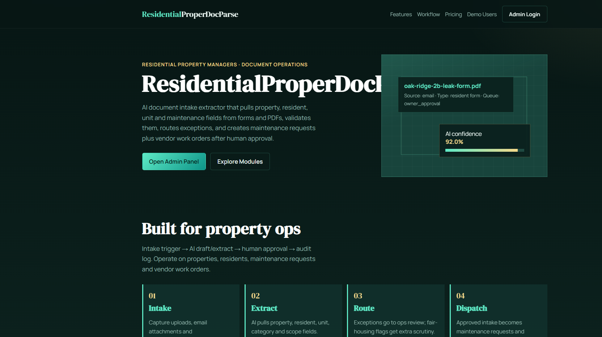
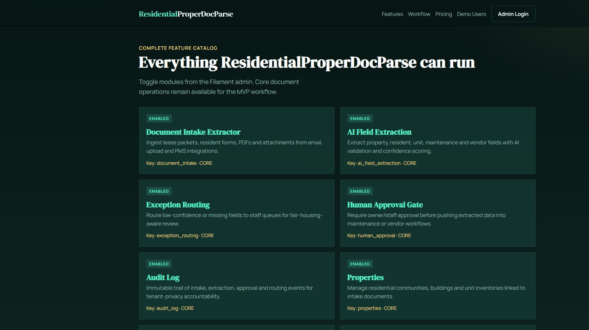
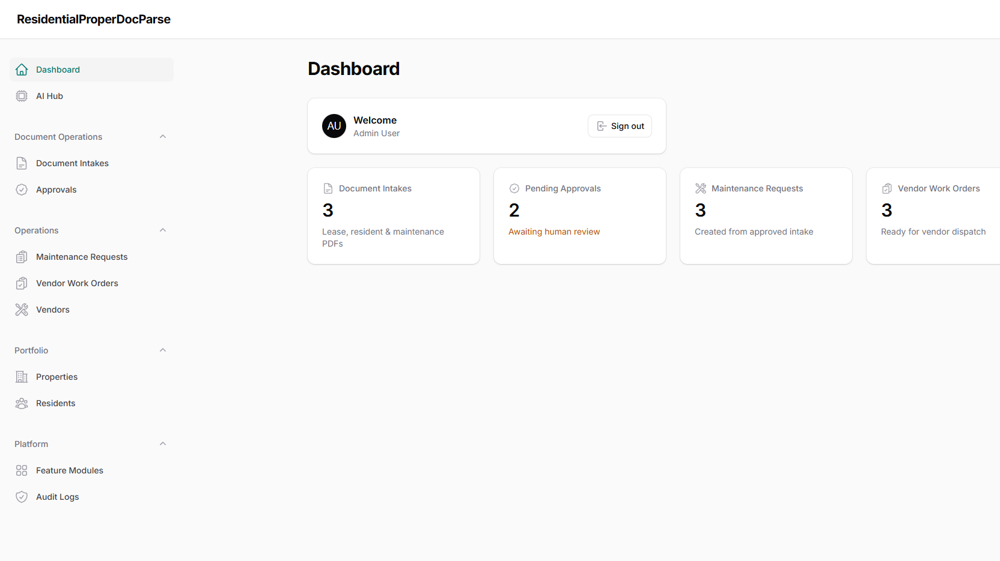
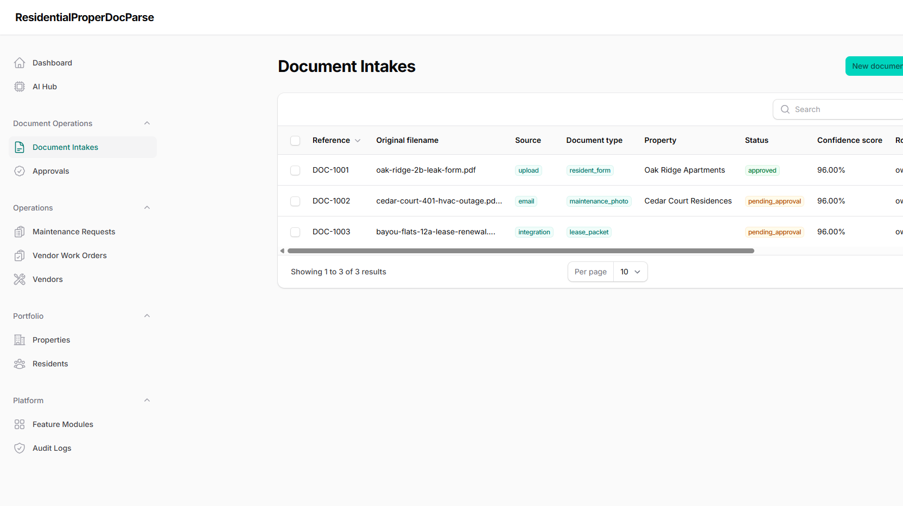

# ResidentialProperDocParse — AI Document Intake Extractor for Residential Property Managers (Laravel + Filament)

**ResidentialProperDocParse** is a modular SaaS document-operations platform for residential property managers. It extracts fields from incoming forms, PDFs and attachments, validates data, routes exceptions, requires human approval, and creates maintenance requests plus vendor work orders — with fair-housing and tenant-privacy awareness baked into the workflow.

## SEO keywords / tags

`residential property managers`, `property management software`, `document intake extractor`, `AI OCR property management`, `lease packet parsing`, `resident form automation`, `maintenance request automation`, `vendor work order software`, `AppFolio alternative workflow`, `Buildium document intake`, `fair housing compliance software`, `tenant privacy automation`, `multifamily operations`, `real estate property sector`, `Laravel Filament SaaS`, `AI business automation`, `document operations`, `exception routing`, `human approval workflow`, `audit log property management`, `email attachment intake`, `accounting vendor sync`, `resident portal documents`, `property portfolio CRM`, `USA property management 2026`

## Problem solved

Property operations teams receive a constant stream of lease packets, resident forms, maintenance photos and vendor invoices. Manual data entry creates delays, missed SLAs and compliance risk. ResidentialProperDocParse automates:

1. **Intake trigger** — upload / email / integration
2. **AI extract & validate** — property, resident, unit, category, scope
3. **Exception routing** — low confidence or fair-housing flags → ops review
4. **Human approval** — owner/staff gate before downstream actions
5. **Audit log** — immutable trail for accountability

## Core entities

- Properties
- Residents
- Document intakes
- Maintenance requests
- Vendors
- Vendor work orders
- Approvals
- Feature modules (toggle ON/OFF)
- Audit logs

## Feature modules

| Module | Default | Purpose |
|---|---|---|
| Document Intake Extractor | ON (core) | Ingest forms/PDFs/attachments |
| AI Field Extraction | ON (core) | Extract + confidence score |
| Exception Routing | ON (core) | Route incomplete/risky docs |
| Human Approval Gate | ON (core) | Approve before dispatch |
| Audit Log | ON (core) | Immutable event trail |
| Properties | ON (core) | Portfolio / communities |
| Residents | ON (core) | Lease contacts + consent |
| Maintenance Requests | ON (core) | Work scopes from intake |
| Vendors | ON (core) | Trade specialty vendors |
| Vendor Work Orders | ON (core) | Dispatch-ready tickets |
| Fair Housing Guard | ON | Flag protected-class risks |
| Tenant Privacy Controls | ON | PII / consent checks |
| Messaging Consent | ON | TCPA-aware messaging flags |
| Unicode PDF Export | ON | Multilingual exports |
| Resident Portal | OFF | Resident upload status |
| AppFolio Integration | OFF | PMS sync |
| Buildium Integration | OFF | PMS sync |
| Email Intake | ON | Ops inbox capture |
| Accounting Integration | OFF | Expense / vendor mapping |
| Attendance Hub | OFF | Crew clock-in |
| AI Parts & Spec Catalog | OFF | Materials enrichment |
| Performance Optimizer | OFF | Drutogoti-style profiling |

Toggle modules in Filament → **Feature Modules**, or via `.env` `MODULE_*` flags.

## Compliance posture (MED/HIGH)

Housing, fair-housing and tenant privacy are treated as first-class concerns:

- Human approval before resident-facing or vendor dispatch actions
- Fair-housing risk flags force exception routing
- Messaging consent and privacy-restricted resident markers
- Full audit logging of extract / approve / route events

This demo is not legal advice; configure modules and review policies with your counsel.

## Demo users

Password for all: `password`

| Role | Email |
|---|---|
| Admin | admin@residentialproperdocparse.test |
| Owner | owner@residentialproperdocparse.test |
| Staff | staff@residentialproperdocparse.test |
| Technician | tech@residentialproperdocparse.test |
| Resident / Customer | customer@residentialproperdocparse.test |

Admin panel: [http://localhost:8121/admin](http://localhost:8121/admin)

## Public pages

- `/` — product hero + live module status
- `/features` — full module catalog
- `/workflow` — intake → extract → approve → audit
- `/pricing` — pilot pricing hypothesis
- `/demo` — demo credentials

## Docker run

```bash
cd pipeline/apps/ResidentialProperDocParse
docker compose up -d --build
```

Services:

- App: http://localhost:8121
- MySQL: localhost:33091
- Redis: localhost:63811

Entrypoint runs `migrate --force` and `db:seed --force` automatically.

Manual re-seed inside container:

```bash
docker exec -it residentialproperdocparse_app php artisan migrate --force
docker exec -it residentialproperdocparse_app php artisan db:seed --force
```

## Tech stack

- PHP 8.4 / Laravel 13
- Filament 4 admin
- MySQL 8.4 + Redis 7
- Docker Compose
- Modular feature flags (`config/modules.php` + DB)
- Packages installed when available: `imrandevbd/laravel-ai-hub`, `imrandevbd/laravel-universal-slug`
- Local equivalents noted for: drutogoti (performance module), laravel-admin-panel (Filament dashboard), laravel-ai-catalog, laravel-attendance-hub, laravel-unicode-pdf

## Screenshots









## Integrations (planned / toggleable)

AppFolio · Buildium · Email intake · Accounting · Attendance devices · AI catalog scrape

## Contact / Hire

- Developer: Imran Ahmed (IMRAN Dev BD)
- Website: https://imrandev.bd/contact
- Email: me@imrandev.bd
- GitHub: https://github.com/imranbru99
